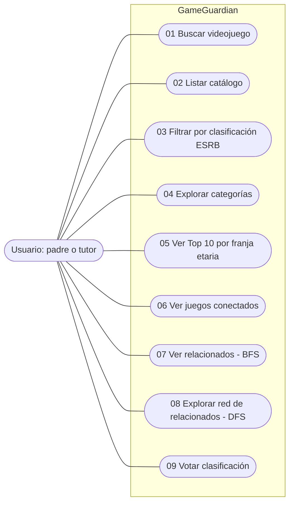

a# Casos de uso - GameGuardian

**Actor:** Usuario (padre/tutor que busca juegos aptos para su hijo).

## Diagrama de casos de uso

El único actor es el usuario (un padre o tutor que busca juegos aptos para su
hijo). Cada óvalo es una opción del menú y su número coincide con el caso
descripto más abajo.

## Lista de casos de uso

Implementados:
- Buscar videojuego (desde TP1, con AVL desde TP4)
- Listar catálogo (TP1)
- Filtrar por clasificación ESRB (TP1)
- Explorar categorías (TP5)
- Ver Top 10 por franja etaria (TP6)
- Ver juegos conectados (TP7)
- Ver relacionados, del más cercano al más lejano (TP8, BFS)
- Explorar la red de relacionados (TP8, DFS)

# 01-Buscar videojuego
- **Precondición:** el catálogo está cargado.
- **Flujo principal:** 1. El usuario elige "Buscar". 2. El sistema pide el título. 3. El usuario lo ingresa. 4. El sistema busca en el árbol AVL y muestra el juego con su clasificación.
- **Flujo alternativo:** si no existe, el sistema informa "No se encontró ese juego".

# 02-Listar catálogo
- **Precondición:** el catálogo está cargado.
- **Flujo principal:** 1. El usuario elige "Listar". 2. El sistema recorre el árbol en inorder y muestra todos los juegos ordenados alfabéticamente.

# 03-Filtrar por clasificación ESRB
- **Precondición:** el catálogo está cargado.
- **Flujo principal:** 1. El usuario elige "Filtrar". 2. Ingresa la clasificación (E, E10+, T, M). 3. El sistema muestra los juegos con esa clasificación.
- **Flujo alternativo:** si ninguno coincide, no se muestra nada.

# 04-Explorar categorías
- **Precondición:** el catálogo está cargado.
- **Flujo principal:** 1. El usuario elige "Explorar categorías". 2. El sistema muestra las categorías (clasificación y género). 3. El usuario escribe una (por ejemplo, T). 4. El sistema lista los juegos de esa categoría.
- **Flujo alternativo:** si la categoría no existe, el sistema informa "No se encontró esa categoría".

# 05-Ver Top 10 por franja etaria
- **Precondición:** el catálogo está cargado.
- **Flujo principal:** 1. El usuario elige "Top 10". 2. Ingresa la clasificación. 3. El sistema arma un heap con los juegos de esa franja y muestra los 10 mejor valorados, de mayor a menor rating.

# 06-Ver juegos conectados
- **Precondición:** el catálogo está cargado.
- **Flujo principal:** 1. El usuario elige "Ver juegos conectados". 2. Ingresa el título de un juego. 3. El sistema muestra los juegos que comparten género o desarrollador con él.
- **Flujo alternativo:** si el juego no existe, el sistema informa "No se encontró ese juego".

# 07-Ver relacionados (BFS)
- **Precondición:** el catálogo está cargado.
- **Flujo principal:** 1. El usuario elige "Relacionados". 2. Ingresa el título de un juego. 3. El sistema recorre el grafo con BFS y muestra los juegos relacionados, del más cercano al más lejano, sin incluir juegos más restrictivos en edad.
- **Flujo alternativo:** si el juego no existe, informa "No se encontró ese juego". Si no hay relacionados aptos, informa "No hay juegos relacionados aptos para esa edad".

# 08-Explorar red de relacionados (DFS)
- **Precondición:** el catálogo está cargado.
- **Flujo principal:** 1. El usuario elige "Explorar red". 2. Ingresa el título de un juego. 3. El sistema recorre el grafo en profundidad y muestra toda la cadena de juegos relacionados, con el mismo filtro de edad.
- **Flujo alternativo:** igual que el caso 07.

# 09-Votar clasificación (pendiente)
- **Flujo principal:** el usuario se identifica con un nickname y vota si la clasificación ESRB le parece acertada, más alta o más baja.
- **Flujo alternativo:** si ya votó ese juego, el sistema lo informa y no registra el voto.