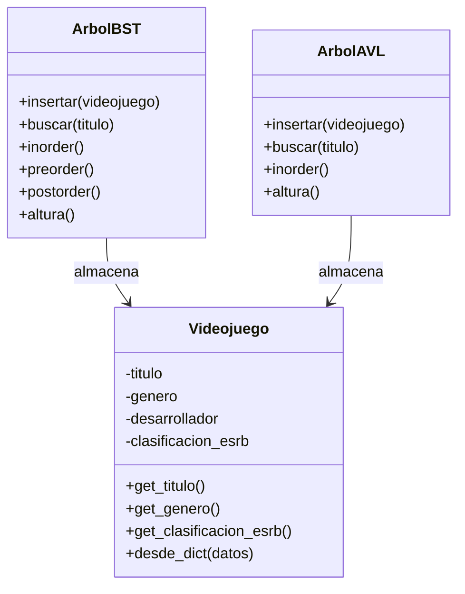

# Diagrama de clases - GameGuardian

**Implementado:** `Videojuego`, `ArbolBST` (TP3), `ArbolAVL` (TP4).
**Pendiente:** `Usuario`, `Voto`, `Heap` (TP6), `Grafo` (TP7) y `Recomendador`.

El menú (`ui/terminal.py`) usa `ArbolAVL`. `ArbolBST` se conserva como punto de
comparación en el experimento de TP4.