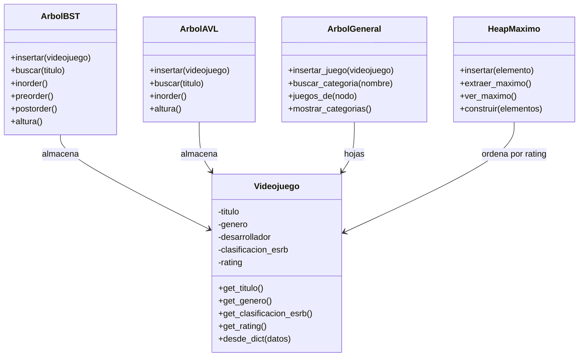

# Diagrama de clases - GameGuardian

**Implementado:** `Videojuego`, `ArbolBST` (TP3), `ArbolAVL` (TP4), `ArbolGeneral` (TP5), `HeapMaximo` (TP6).
**Pendiente:** `Usuario`, `Voto`, `Grafo` (TP7) y `Recomendador`.

El menú (`ui/terminal.py`) usa `ArbolAVL` (buscar y listar), `ArbolGeneral`
(categorías) y `HeapMaximo` (Top 10). `ArbolBST` se conserva como punto de
comparación en el experimento de TP4.