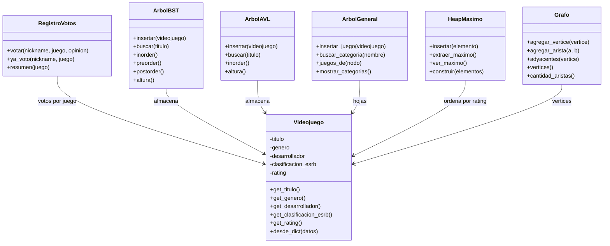

# Diagrama de clases - GameGuardian

**Implementado:** `Videojuego`, `ArbolBST` (TP3), `ArbolAVL` (TP4), `ArbolGeneral` (TP5), `HeapMaximo` (TP6), `Grafo` (TP7), `RegistroVotos` (votación de la comunidad).
**Funciones de recorrido (TP8):** `bfs()` y `dfs()` en `algoritmos/`, que recorren el `Grafo`. La recomendación de juegos relacionados se resuelve con ellas, por eso no hay una clase `Recomendador`.
**Sin clases `Usuario` y `Voto`:** el usuario es su nickname y el voto es una de tres opiniones, así que alcanza con `RegistroVotos`.

El menú (`ui/terminal.py`) usa `ArbolAVL` (buscar y listar), `ArbolGeneral`
(categorías), `HeapMaximo` (Top 10), `Grafo` (juegos conectados) y, sobre el
grafo, `bfs()` y `dfs()` (relacionados, con filtro por edad). `ArbolBST`
se conserva como punto de comparación en el experimento de TP4.