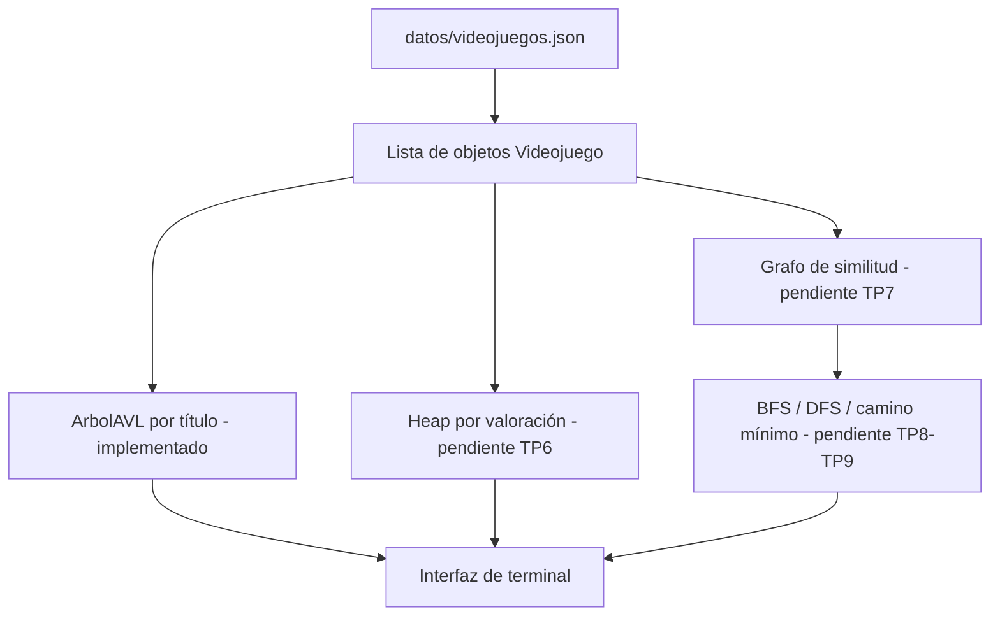

# Conexión entre estructuras - GameGuardian

**Estado actual:** el JSON se carga como lista de `Videojuego`, y esa lista se
inserta en el AVL, que atiende las opciones de buscar y listar. El filtro por
clasificación recorre la lista directamente.
Este documento se completa a medida que se suman el heap y el grafo.