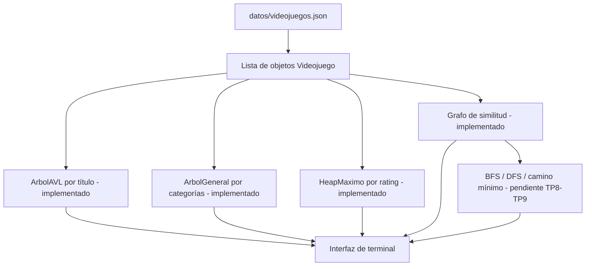

# Conexión entre estructuras - GameGuardian

**Estado actual:** el JSON se carga como lista de `Videojuego`, y esa lista
alimenta cuatro estructuras:

- **ArbolAVL**, ordenado por título: atiende las opciones de buscar y listar.
- **ArbolGeneral**, con la jerarquía clasificación → género → videojuego:
  atiende "Explorar categorías".
- **HeapMaximo**, ordenado por rating: atiende el Top 10 por clasificación.
  Se arma en cada consulta con los juegos de la clasificación elegida.
- **Grafo** de similitud (no dirigido, sin pesos, lista de adyacencia): atiende
  "Ver juegos conectados a uno". Va a alimentar BFS, DFS y el camino mínimo.

El filtro por clasificación recorre la lista directamente.
Este documento se completa a medida que se suman las etapas siguientes.