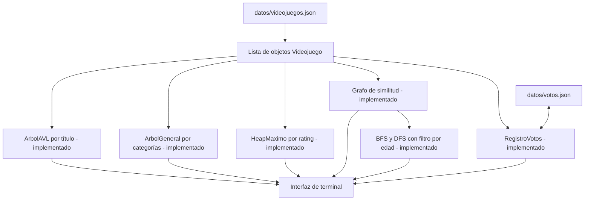

# Conexión entre estructuras - GameGuardian

**Estado actual:** el JSON se carga como lista de `Videojuego`, y esa lista
alimenta cinco estructuras:

- **ArbolAVL**, ordenado por título: atiende buscar y listar.
- **ArbolGeneral**, con la jerarquía clasificación → género → videojuego:
  atiende "Explorar categorías".
- **HeapMaximo**, ordenado por rating: atiende el Top 10 por clasificación.
- **Grafo** de similitud (no dirigido, sin pesos, lista de adyacencia): atiende
  "Ver juegos conectados" y alimenta los recorridos **BFS** (cola) y **DFS**
  (pila), que muestran los juegos relacionados sin salirse de la franja de edad.
- **RegistroVotos**: guarda un voto por usuario y por juego, y los lee y escribe
  en `datos/votos.json` para que no se pierdan al cerrar el programa. Atiende
  "Votar la clasificación".

El filtro por clasificación recorre la lista directamente.
El camino mínimo (TP9) queda fuera de alcance.